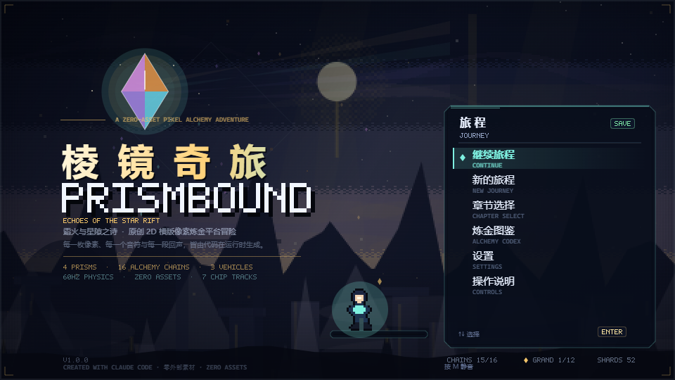
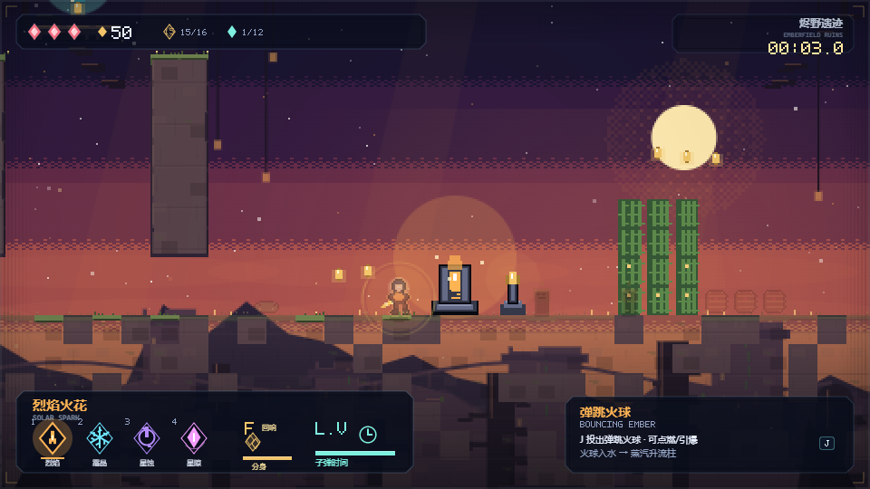
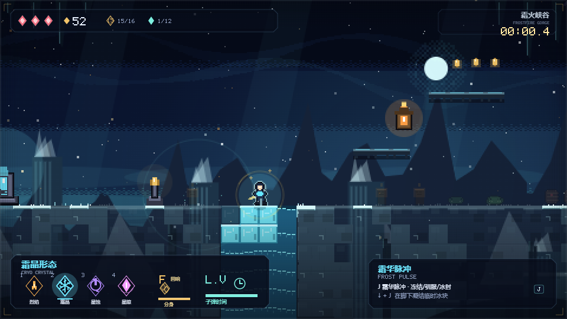
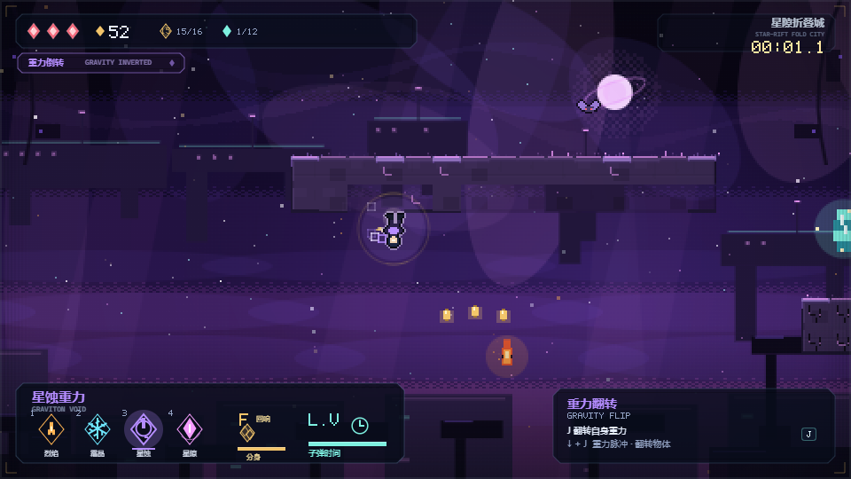
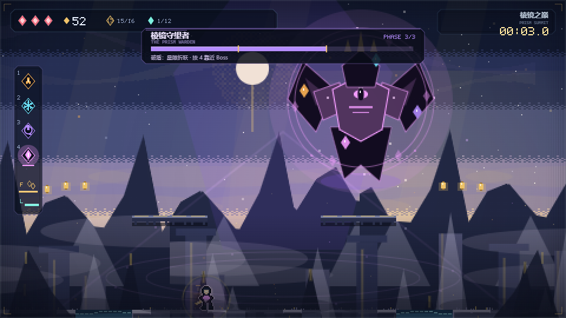
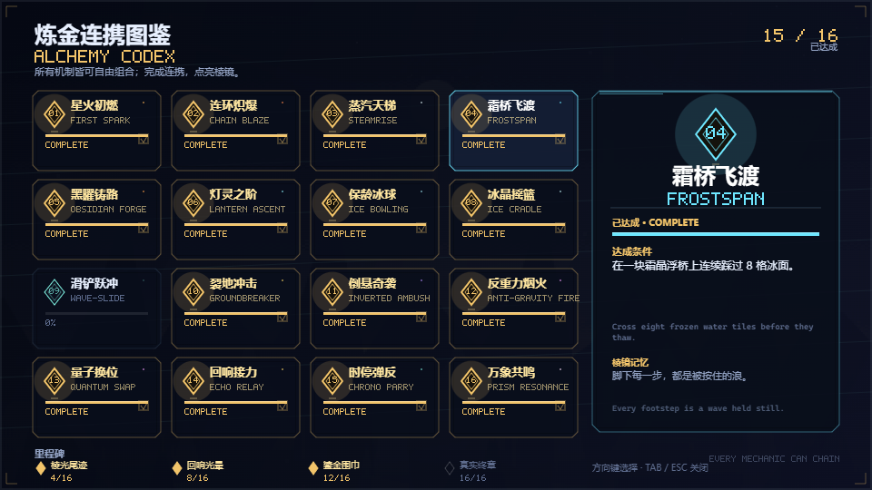
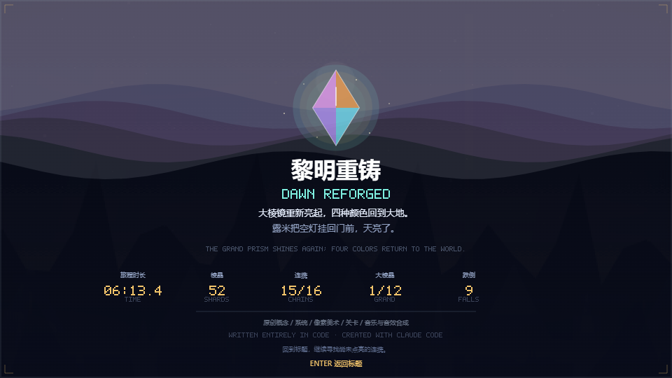

# 棱镜奇旅 · PRISMBOUND

> 一款**原创 2D 横版像素炼金平台冒险**。  
> 480×270 纯低分像素世界 · 960×540 清晰双语 UI · 60Hz 固定物理 · 零外部素材 · 全部像素、音乐与音效由代码实时生成。



## 立即开始

**最简单的开玩方式：双击 `index.html`。**

游戏没有任何外部素材、构建步骤或运行时依赖；`index.html`、`css/`、`js/` 拷到任何地方都能直接运行。推荐使用最新版 Chrome / Edge（桌面端）。

- 打开后按 **Enter** 或点击画面唤醒音频（浏览器要求先有用户手势）。
- 如果想通过本地服务器运行：

```bash
python -m http.server 4173
```

然后访问 `http://127.0.0.1:4173/`。

## 操作

| 按键 | 功能 |
| --- | --- |
| `←` `→` / `A` `D` | 移动 |
| `Space` / `Z` | 跳跃；按住跳得更高；空中再按一次 = 二段旋跳 |
| `Shift` / `X` | 八向冲刺（空中可向八个方向）；滑铲中按跳跃可衔接 **滑铲跃冲 Wave-Slide** |
| `↓`（奔跑中） | 高速滑铲；可钻过 1 格高的窄洞，撞飞敌人与冰块 |
| 空中 `Shift + ↓` | 陨石砸地；震飞周围敌人、砸碎裂缝地板；砸到陨石弹簧会双倍弹射 |
| `1` `2` `3` `4` | 切换四棱镜形态（烈焰 / 霜晶 / 星蚀 / 星隙） |
| `J` / `E` | 当前形态技能 |
| `↓ + J` | 次级形态技能（霜晶：脚下凝结临时冰块；星蚀：重力脉冲） |
| `F` | 回响分身：点按开始录制 4 秒；再次点按可提前释放 |
| 按住 `L` / `V` | 子弹时间：世界、音乐与时间一起减速；时停中踩踏/冲刺可弹反能量弹 |
| `Tab` | 打开 **16 种炼金连携图鉴**，查看进度与奖励 |
| `Esc` / `P` | 暂停 / 返回 |
| `M` | 静音 |
| 手柄 | `A` 跳跃 · `X` 冲刺 · `Y` 技能 · `B` 回响 · `LB/RB` 切换形态/时停 · `START` 暂停 |

## 核心特色

### 丝滑的平台手感
可变跳高、土狼时间（Coyote Time）、输入缓冲、4px 头顶角落顺滑纠偏、二段旋跳、墙壁滑行与蹬墙跳、八向空中冲刺、可钻 1 格矮洞的高速滑铲、滑铲起跳触发的超速惯性 **Wave-Slide**、空中 `Shift+↓` 陨石砸地，以及“砸向陨石弹簧 → 双倍弹射”的空中连段。

所有计时都跑在 **60Hz 固定物理步长** 上；渲染可以做插值与平滑，物理判定永远稳定、可复现。

### 四大原创棱镜形态
| 形态 | 核心能力 |
| --- | --- |
| **烈焰火花 SOLAR SPARK** | 弹跳火球：点燃藤蔓、引爆连锁炸药桶、给铜线通电关闭激光门；火球落入水面会蒸出一根托举主角与物体的**蒸汽升流柱**；击中冰封敌人触发**热震碎裂**。 |
| **霜晶形态 CRYO CRYSTAL** | 冻结水面生成**霜晶浮桥**；急冷熔岩凝结**黑曜石板**；驯服火焰灯笼灵变为悬浮弹跳踏板；冰封敌人变成可站立、可踢飞的**保龄冰球**；`↓+J` 在脚下凝结临时冰块。 |
| **星蚀重力 GRAVITON VOID** | `J` 翻转自身重力、倒悬行走；切换其他形态后仍保留侧悬墙贴空跳；`↓+J` 重力脉冲翻转敌人、木箱与炸药桶，让炸药“向上坠落”炸开穹顶密室。 |
| **星隙折跃 WARP PRISM** | `J` 抛出星棱，再按 `J` 保留动量瞬移；星棱钉在敌人/炸药桶上时与其**量子换位**；被动让隐藏假墙泛起翡翠微光。 |

### 回响分身 & 子弹时间
- **回响分身**：录制 4 秒行动，释放金色分身复刻你的路径与元素技能；它能替你压住机关，也能成为踩踏升空的垫脚石。
- **子弹时间**：按住 `L/V` 让世界慢下来，音乐同步减速并压暗高频；时停中踩踏/冲刺可把 Boss 能量弹打回去。

### 四章主题关卡、三种载具、三阶段 Boss
- **烬野遗迹**：夕阳下的遗迹、藤蔓与炸药桶，取得烈焰火花与回响分身。
- **霜火峡谷**：冻结湖面、冷却熔岩、灯笼高塔；驾驶 **熔核矿车** 冲过熔岩湖。
- **星隙折叠城**：倒悬的城市、重力回廊、可弹反的棱镜炮塔；骑乘 **霜翼滑翔翼** 穿越星隙。
- **棱镜之巅**：折跃跨过深渊、驾驶 **棱镜机兵** 突破装甲墙，在「棱镜守望者」的三阶段终局战中用四种形态轮番破盾。

### 16 种炼金连携图鉴
按 `Tab` 查看 16 个可自由组合的连携挑战；完成时会出现金色连携横幅、音效与屏幕反馈，并永久记录。完成 4/8/12/16 个连携会逐步解锁棱光尾迹、回响光晕、鎏金围巾与**真实终章**。

> 图鉴包含：星火初燃、连环炽爆、蒸汽天梯、霜桥飞渡、黑曜铸路、灯灵之阶、保龄冰球、冰晶摇篮、滑铲跃冲、裂地冲击、倒悬奇袭、反重力烟火、量子换位、回响接力、时停弹反、万象共鸣。

## 画面欣赏



*烬野遗迹：夕阳、藤蔓、炸药桶与第一座棱镜祭坛。*



*霜火峡谷：用霜华脉冲把湖面冻成可行走的霜晶浮桥。*



*星隙折叠城：翻转重力，沿天花板的背面倒悬行走。*



*三阶段 Boss「棱镜守望者」：每一阶段都需要对应形态破盾；子弹时间可弹反能量弹。*



*16 种炼金连携的实时图鉴（Tab）。*



*结局「黎明重铸」。完成全部 16 连携可解锁真实终章。*

## 技术实现

- **双层整数像素渲染**：世界先绘制到 480×270 离屏 Canvas，再以整数倍最近邻放大；UI 在 960×540 设计坐标中单独绘制，中文保持清晰、英文使用手工像素字形。
- **程序化美术**：地形自动拼接、岩层、雪冠、草丛、花朵、晶簇、冰锥、视差山脉、遗迹、浮空城、极光、天气、粒子……全部由 Canvas 代码生成。
- **纯 Web Audio 音频**：自写多轨步进音序器 + 脉冲波/三角波/钹/噪声鼓组、程序化混响与延迟、动态低通和子弹时间变速；7 首原创曲目共享同一“棱镜动机”，随章节变形。
- **纯代码物理**：轴分离 AABB 瓦片碰撞、单向平台、移动平台载人、冻结/融化动态地形、蒸汽升流、重力翻转、回响平台。
- **无外部素材**：没有任何图片、字体、音频文件或网络请求；声音由振荡器和噪声在运行时合成。

## 项目结构

```
index.html            入口，按顺序加载无模块脚本
css/style.css         画布外框、居中与像素缩放
js/core.js            常量、工具、事件总线、localStorage 存档
js/input.js           键盘 / 手柄输入与边缘缓冲
js/font.js            内置 5×7 像素字体 + 中文排版
js/audio.js           Web Audio 合成器、音序器、音效
js/music.js           7 首原创芯片配乐数据
js/sprites.js         主角/敌人/道具像素画与描边缓存
js/levels.js          四章地图与关卡实体数据
js/world.js           瓦片碰撞、元素交互、机关与世界更新
js/entities.js        敌人、道具、机关、载具、投射物
js/player.js          主角手感、四形态、回响、子弹时间
js/boss.js            三阶段棱镜守望者
js/chains.js          16 连携的追踪、存档与奖励
js/gfx.js             双层渲染、视差、地形、粒子、天气
js/ui.js              标题、HUD、图鉴、祭坛、菜单、结局
js/game.js            状态机、章节流程、摄像机、存档
js/main.js            启动与主循环
```

## 存档与设置
进度保存在浏览器 `localStorage`（键名 `prismbound.save.v1`）：章节、检查点、形态、连携、大棱晶、最佳时间与音量设置。标题页可以继续旅程、选择已解锁章节、开始新旅程（会二次确认），或打开图鉴/设置/操作说明。

## 开发调试
在浏览器控制台可以使用 `PB.DEBUG`：

```js
PB.DEBUG.unlockForms()      // 解锁四形态
PB.DEBUG.unlockArts()       // 解锁回响与子弹时间
PB.DEBUG.loadChapter(3)     // 直接进入第 4 章
PB.DEBUG.teleport(2400,334) // 传送（世界像素坐标）
PB.DEBUG.chain('chronoParry')
PB.DEBUG.boss()
PB.DEBUG.state()
```

## 说明
- 音频必须由用户手势启动（浏览器自动播放策略），首次按键后才会响起。
- 推荐桌面 Chrome / Edge；使用系统字体渲染中文，因此不同系统上中文外观会有细微差异。
- 所有代码、像素画、关卡和音乐均为本项目的原创运行时生成内容；没有复制任何外部游戏素材。

---

**设计与程序**：Claude（Claude Code）  
**引擎**：原生 HTML5 Canvas + Web Audio API，零依赖  
**版本**：1.0.4 · 2026
